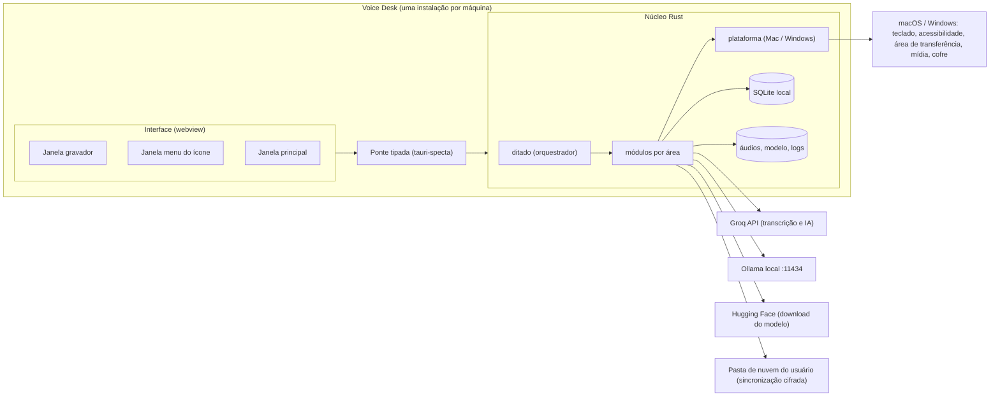
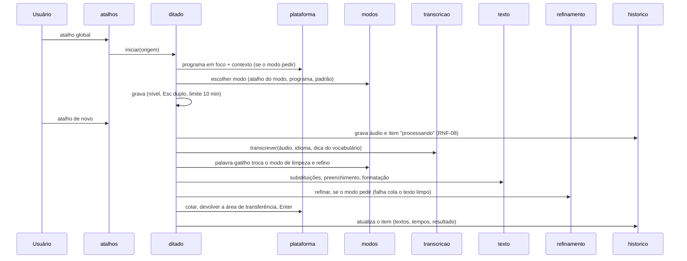
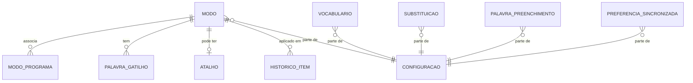
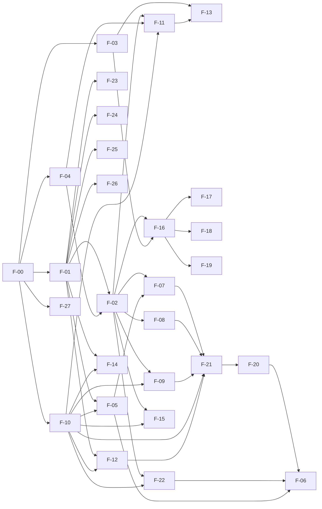

# Arquitetura: Voice Desk

> Status: mudança de escopo para aprovação (ENG-104) · Versão: 2 · Atualizado em: 2026-10-27
> Fontes: [prd.md](../produto/prd.md) v3, [design.md](../design/design.md) (escopo v3) e protótipo, [relatório de engenharia reversa](../produto/engenharia-reversa/relatorio.md) (só como referência de comportamento), [deploy.md](deploy.md) (Igor, ENG-56, commit `5e14374`)
> Paradigma: app de desktop com núcleo nativo em Rust e interface web local (Tauri 2), monólito modular organizado por área do sistema, sem servidor

## 1. Resumo

> **Escopo v1 depois da ENG-104:** o BD tirou da v1 os Épicos 3 (modos e refinamento), 4 (histórico), 5 (sincronização e exportação) e 6 (transcrição local). A v1 é E-01 → E-02 → E-07, só com o Groq. **Nada muda no esquema do banco**: as tabelas dos épicos cortados ficam vazias até eles voltarem. Os módulos `refinamento`, `modelo_local`, `historico` (telas), `sincronizacao` e `modos/escolha` não são construídos na v1. As opções de cada ditado ficam no modo padrão "Ditado", sem tela de modos, e cada ditado guarda só dados técnicos (ADR-11). Efeitos, lacunas e ordem do que fica: [impacto-corte-epicos-3-a-6.md](impacto-corte-epicos-3-a-6.md). O resto deste documento descreve a arquitetura completa; o que é dos épicos cortados vale como referência para a volta deles.

O Voice Desk é **um único app de desktop** para macOS 14+ e Windows 10 22H2/11, feito com **Tauri 2**. O **núcleo em Rust** faz tudo o que é sistema e tempo crítico: atalho global, captura de áudio, transcrição (Groq ou whisper.cpp local), limpeza do texto, refinamento (Groq ou Ollama), colagem no programa em foco, cofre de chaves, banco SQLite local, retenção e sincronização. A **interface em React + TypeScript** roda no webview do sistema (WebKit no Mac, WebView2 no Windows) e desenha as três superfícies do design: gravador flutuante, menu do ícone e janela de configuração. Não há back-end nosso. A sincronização entre máquinas usa **uma pasta de nuvem do próprio usuário** (OneDrive, Google Drive, Dropbox ou iCloud Drive), com o conteúdo cifrado por uma frase secreta dele. Conforme o `deploy.md` do Igor, não há Dokploy: o GitHub Actions gera os instaladores a cada merge (pré-release `dev-<sha>`), o GitHub Releases guarda as versões e o GitHub Pages publica a página do projeto. As telas também rodam no navegador em **modo simulado**, para os testes da Marta e a conferência da Nina.

## 2. Stack

Versões estáveis conferidas em 2026-10-23 (npm, crates.io, nodejs.org, rust-lang.org). Fixe a versão menor no F-00; atualização de dependência é história própria.

| Camada | Escolha | Versão | Motivo (curto) |
|---|---|---|---|
| Casca do app | Tauri | 2.12 | Um código para Mac e Windows; webview do sistema (leve, ajuda a RNF-03); acesso nativo pelo Rust; bandeja, atalho global e início automático com plugins oficiais. ADR-01 |
| Núcleo | Rust (edição 2024) | 1.99 estável | APIs de sistema (acessibilidade, teclado, mídia, cofre) e whisper.cpp sem ponte extra; desempenho para RNF-01/02 |
| Interface | React + TypeScript + Vite | React 19.3 · TS 7.0 · Vite 8.3 | Popular, com starter oficial do Tauri (`create-tauri-app`, modelo `react-ts`); reaproveita CSS e tokens do protótipo |
| Rotas da janela | React Router (modo hash) | 8.5 | Mesmas rotas do protótipo (`#/modos`, `#/historico/101`…) |
| Estado vindo do núcleo | TanStack Query | 5.104 | Cache e invalidação das chamadas ao núcleo; sem estado global próprio |
| Ponte núcleo ↔ interface | tauri-specta + specta | `=2.0.0-rc.26` / `=2.0.0-rc.27` (fixadas) | Gera `src/ipc/bindings.ts` com tipos e funções de todos os comandos e eventos; ninguém escreve `invoke` à mão. ADR-06 |
| Banco local | SQLite com FTS5, via rusqlite (`bundled`) | 0.40 | Arquivo único por máquina; busca de texto (RF-16.2) sem servidor |
| Migrações | migrador próprio de ~40 linhas em `nucleo/banco` (arquivos `.sql` embutidos, ordem por data no nome) | — | Evita conflito de numeração entre 3 Devs (seção 8) |
| Áudio | cpal (captura) · rubato (reamostragem 16 kHz) · flacenc/claxon (FLAC) · rodio (sons) · earshot (detecção de fala) | 0.18 · 5.0 · 0.5/0.4 · 0.23 · 1.2 | Multiplataforma, sem dependência de serviço |
| Transcrição local | whisper-rs (whisper.cpp) com Metal no Mac e CPU no Windows | 0.16 | Mesmo motor que o VoiceInk usa; modelo `ggml-large-v3-turbo-q5_0.bin` (574 MB). ADR-05 |
| HTTP para provedores | reqwest (rustls) + tokio | 0.13 · 1.54 | TLS obrigatório (RNF-06) |
| Cofre de chaves | arquivo cifrado do app (XChaCha20-Poly1305, chave derivada do id da máquina; ADR-10) | chacha20poly1305 0.11 | RF-04, RNF-06 |
| Teclado e colagem | tauri-plugin-global-shortcut · handy-keys (escuta sem consumir, para o Esc duplo) · enigo (teclas simuladas) · arboard (área de transferência) | 2.4 · 0.3 · 0.6 · 3.7 | Usados juntos em produção pelo Handy (app livre de ditado em Tauri, MIT) |
| Janela sem roubar foco | tauri-nspanel (Mac, painel não ativável) · estilo `WS_EX_NOACTIVATE` via crate `windows` (Windows) | 2.1 · 0.62 | RF-01.2: o gravador não tira o foco |
| Plugins Tauri | autostart · single-instance · positioner · dialog · opener | 2.7 · 2.5 · 2.4 · 2.8 · 2.7 | Iniciar com o sistema (RF-05.2), instância única, menu junto do ícone, escolher pasta/arquivo, abrir links |
| Sincronização | pasta escolhida pelo usuário + chacha20poly1305 (XChaCha20-Poly1305) + argon2 (Argon2id) + notify | 0.11 · 0.6 · 8.2 | Sem servidor e sem custo (seção 10 do PRD). ADR-03 |
| Logs | tracing + tracing-appender (arquivo diário, 7 arquivos) | 0.1 · 0.2 | RNF-09 |
| Testes unitários | `cargo test` (Rust) · Vitest + Testing Library + jsdom (interface) | — · 5.0 · 16.3 · 30.1 | Seção 9 |
| Testes de integração HTTP | wiremock | 0.6 | Groq e Ollama simulados |
| Testes e2e | Playwright | 1.64 | Telas em modo simulado (Marta) |
| Lint/formatação | rustfmt + clippy · Biome | — · 2.6 | Uma ferramenta para TS (lint e formatação) |
| Pacotes JS | pnpm · Node 24 LTS (só no build) | 12.15 · 24.22 | Node não vai dentro do app |
| Execução/deploy | instaladores pelo GitHub Actions, GitHub Releases e GitHub Pages; sem Dokploy (detalhes no `deploy.md` do Igor) | — | ADR-08 |

## 3. Visão de componentes



**Regras de dependência**
- A interface só fala com o núcleo pelos comandos e eventos gerados em `src/ipc/bindings.ts`. Ela **não** acessa rede, arquivos, banco nem área de transferência por conta própria.
- Toda regra de negócio e toda validação que vale de verdade ficam no núcleo; a interface só repete checagens simples (campo vazio, tamanho) para responder rápido.
- Dentro do núcleo: `comandos.rs` → `servico.rs` → `repositorio.rs` em cada módulo. Um módulo usa outro só pelo `servico` público dele, nunca pelo repositório nem pelas tabelas dele.
- Só o módulo `plataforma` tem código específico de sistema (`#[cfg(target_os = ...)]`). Os outros módulos não sabem em que sistema estão.
- Só os módulos de provedor (`transcricao`, `refinamento`, `modelo_local`) e `sincronizacao` acessam a rede ou a pasta de nuvem.

**Fluxo do ditado (o coração do produto)**



## 4. Modelo de dados

Um arquivo SQLite por máquina (`voice-desk.db` na pasta de dados do app). Os termos seguem o glossário do PRD.



`CONFIGURACAO` é o conceito "configuração sincronizável", não uma tabela.

**Colunas comuns a toda tabela sincronizável** (`modo`, `modo_programa`, `palavra_gatilho`, `vocabulario`, `substituicao`, `palavra_preenchimento`, `preferencia_sincronizada`): `id` (UUID v7, texto), `atualizado_em` (relógio lógico híbrido, texto ordenável), `atualizado_por` (id da máquina), `excluido_em` (exclusão lógica, para a sincronização saber que o item foi apagado). Toda escrita nessas tabelas passa por `configuracao::gravar()`, que preenche essas colunas e avisa a sincronização.

| Entidade | Campos principais | Regras |
|---|---|---|
| `modo` (sincroniza) | nome, emoji, idioma (`pt-BR`, `en`, `auto`), transcricao_provedor (`groq`, `whisper_local`), transcricao_modelo, remover_preenchimento, formatar, refinar, ia_provedor (`groq`, `ollama`), ia_modelo, prompt, contexto_selecao, contexto_area_transferencia, enviar_enter, ordem | Nome único entre os não excluídos, até 40 caracteres; prompt até 4.000 (RF-10.4). Modos iniciais "Ditado", "E-mail", "Chat" |
| `modo_programa` (sincroniza) | modo_id, plataforma (`macos`, `windows`), identificador (Mac: bundle id, ex. `com.tinyspeck.slackmacgap`; Windows: nome do executável em minúsculas, ex. `outlook.exe`), nome_exibicao | (plataforma, identificador) único: cada programa em um só modo (RF-12.2) |
| `palavra_gatilho` (sincroniza) | modo_id, palavra, palavra_normalizada | palavra_normalizada única (RF-15.1) |
| `vocabulario` (sincroniza) | palavra, palavra_normalizada | Única sem diferenciar maiúsculas; até 500 itens (RF-07.4) |
| `substituicao` (sincroniza) | original, original_normalizado, substituto, ativa | original não vazio; original_normalizado único |
| `palavra_preenchimento` (sincroniza) | palavra, palavra_normalizada | Lista inicial em português e inglês |
| `preferencia_sincronizada` (sincroniza) | chave, valor (JSON) | Ex.: `modo_padrao_id`. Chave única |
| `atalho` (local) | escopo (`global` ou `modo:<id>`), combinacao (formato do plugin, ex. `CommandOrControl+Alt+Space`) | combinacao única; não sincroniza (F-14) |
| `preferencia_local` (local) | chave, valor (JSON) | Microfone, sons, pausar mídia, descartar sem fala, retenção, iniciar com o sistema, primeiro uso concluído, endereço do Ollama, dados da sincronização |
| `historico_item` (local) | criado_em, modo_id, modo_nome, modo_emoji, programa_plataforma, programa_identificador, programa_nome, duracao_audio_ms, audio_arquivo, audio_apagado_em, estado (`processando`, `colado`, `nao_colado`, `falhou`, `cancelado`), transcricao_provedor, transcricao_modelo, texto_transcrito, texto_limpo, texto_final, refinamento_estado (`nao_aplicado`, `ok`, `falhou`), refinamento_provedor, refinamento_modelo, refinamento_motivo, tempo_transcricao_ms, tempo_refinamento_ms, tempo_total_ms, contexto_selecao, contexto_area_transferencia, contexto_cortado, contexto_aviso, erro_codigo, erro_mensagem | Não sincroniza. Nome, emoji e programa ficam copiados no item (o modo pode mudar depois). Ao abrir o app, itens em `processando` viram `falhou` (RNF-08) |
| `historico_busca` (local) | tabela virtual FTS5 sobre texto_transcrito e texto_final | Mantida por gatilhos SQL; busca em até 1 s com 5.000 itens (RF-16.2) |
| `modelo_local` (local) | arquivo, tamanho_bytes, sha256, estado (`nao_baixado`, `baixando`, `pausado`, `pronto`), bytes_baixados | `pronto` só depois de conferir o SHA-256 (RF-22.4) |
| `sincronizacao_estado` (local) | dispositivo_id, nome_dispositivo, pasta, espaco_id, relogio, ultima_leitura_em, ultima_escrita_em, pendente, ultimo_erro | Uma linha por máquina |
| `_migracao` (local) | nome, aplicada_em | Controle do migrador |

**Fora do banco**
- Áudio: `audios/AAAA/MM/<id do item>.flac`, 16 kHz mono (cerca de 1 MB por minuto). Só o módulo `audio` lê e grava esse formato.
- Modelo local: `modelos/ggml-large-v3-turbo-q5_0.bin`. O download vai para `.parcial` e só é renomeado depois da conferência do SHA-256.
- Logs: `logs/voice-desk.AAAA-MM-DD.log`.
- Chaves de API e a chave da sincronização: só no cofre em arquivo cifrado do app (`chaves.vdk` na pasta de dados, contas `groq` e `sincronizacao`; ADR-10).
- Pasta de dados: a pasta de dados do app de cada sistema, com o identificador `br.com.going2.voicedesk`.

## 5. APIs

Não há API HTTP nossa. Os contratos são de dois tipos.

**5.1 Comandos e eventos entre interface e núcleo**
- Comandos Tauri em Rust, nomeados `<area>_<verbo>` (ex.: `modos_listar`, `modos_salvar`, `historico_buscar`). Os tipos (`#[derive(specta::Type)]`) geram `src/ipc/bindings.ts` ao rodar o app em modo de desenvolvimento; o arquivo é versionado e a revisão do Igor confere se está atualizado.
- Eventos do núcleo para a interface, nomeados `<area>:<fato>` (ex.: `ditado:estado`, `ditado:nivel`, `sincronizacao:estado`, `modelo_local:progresso`).
- Erro: todo comando devolve `Result<T, ErroApp>`, serializado como `{ "codigo": "modo_nome_duplicado", "mensagem": "Já existe um modo com esse nome.", "campo": "nome" }`. `codigo` em `snake_case` estável (a interface decide o texto pelo código quando precisar); `mensagem` já em português, no tom do design (o que houve e o que fazer); `campo` só em validação.
- Listas pequenas (modos, vocabulário, substituições) vêm inteiras. O histórico pagina por cursor: `historico_buscar({ termo, antes_de, limite })`, com limite padrão de 50.

| Comandos (prefixo) | Funcionalidade | Observação |
|---|---|---|
| `ditado_*`, eventos `ditado:*` | F-01, F-03, F-26 | Iniciar, parar, cancelar; estado do gravador |
| `atalhos_*` | F-01 (RF-01.1), F-14 | Validar e salvar sem reiniciar |
| `chaves_*` | F-04 | Salvar (testa no provedor), apagar, estado; nunca devolve a chave, só os 4 últimos caracteres |
| `bandeja_*` | F-05 | Estado do ícone, iniciar com o sistema |
| `permissoes_*` | F-06, F-03, F-13 | Estado e abrir a tela do sistema |
| `vocabulario_*` | F-07 | Inclui a caixa rápida |
| `substituicoes_*` | F-08 | |
| `limpeza_*` | F-09 | Prévia ao vivo |
| `modos_*` | F-10, F-12, F-14, F-15 | Inclui `modos_programas_disponiveis` |
| `provedores_*` | F-02, F-11 | Modelos do Groq e do Ollama |
| `historico_*` | F-16 a F-19 | Buscar, detalhe, copiar, excluir, apagar tudo, transcrever de novo, exportar CSV |
| `retencao_*` | F-17 | |
| `sincronizacao_*`, evento `sincronizacao:estado` | F-20 | |
| `configuracao_exportar`, `configuracao_importar_previa`, `configuracao_importar` | F-21 | |
| `modelo_local_*`, evento `modelo_local:progresso` | F-22 | |
| `audio_microfones`, `audio_sons_*` | F-23, F-24 | |
| `preferencias_*` | F-25, F-26 e o resto da tela Geral | |
| `app_sobre`, `app_abrir_pasta_logs` | F-27, RNF-09 | |

**5.2 Provedores externos (feitos pelo núcleo)**

| Provedor | Uso | Endpoint | Regras |
|---|---|---|---|
| Groq | Transcrição (F-02) | `POST https://api.groq.com/openai/v1/audio/transcriptions` (multipart: `file` FLAC, `model` `whisper-large-v3-turbo` ou `whisper-large-v3`, `language` ISO-639-1 ou omitido no automático, `prompt` com a dica do vocabulário, `response_format=json`) | Limite de 30 s (RF-02.3). Arquivo até 25 MB no plano gratuito (10 min em FLAC ≈ 10 MB). **`prompt` limitado a 224 tokens** (ver riscos) |
| Groq | Refinamento (F-11) | `POST https://api.groq.com/openai/v1/chat/completions` | Limite de 15 s (RF-11.3) |
| Groq | Validar chave e listar modelos (F-04, F-11) | `GET https://api.groq.com/openai/v1/models` | Limite de 10 s (RF-04.2) |
| Ollama | Refinamento e modelos (F-11) | `POST http://localhost:11434/api/chat` (`stream: false`), `GET /api/tags` | Endereço configurável, padrão local |
| Hugging Face | Modelo local (F-22) | `GET https://huggingface.co/ggerganov/whisper.cpp/resolve/main/ggml-large-v3-turbo-q5_0.bin` com `Range` para retomar | SHA-256 fixado no código |

Cada provedor implementa um contrato do núcleo (`Transcritor` ou `Refinador`, em `transcricao/mod.rs` e `refinamento/mod.rs`). Provedor novo na v2 é um arquivo novo que implementa o contrato.

## 6. Autenticação, autorização e segurança

- **Sem login.** Cada instalação pertence a quem a instalou (PRD 2.1). Não há perfis nem checagem de permissão de usuário. O que se protege são as chaves, os dados ditados e a sincronização.
- **Superfície da ponte:** só os comandos registrados no núcleo são chamáveis; capacidades Tauri (`src-tauri/capabilities/`) liberam para as janelas só os plugins usados. Sem `shell`, sem `fs` liberado para a interface. A interface carrega só arquivos locais do app (CSP sem origens remotas).
- **Chaves de API (RNF-06):** só no cofre cifrado do app (ADR-10). Nunca no banco, em texto puro, no log, na exportação ou na sincronização. O núcleo lê a chave na hora da chamada e não a devolve à interface; o comando de estado devolve `••••` + 4 últimos caracteres.
- **Rede:** só HTTPS para Groq e Hugging Face (rustls); Ollama só por endereço local por padrão (se o usuário trocar para outro endereço, a tela avisa que o texto sai da máquina).
- **Dados ditados (RNF-07, LGPD):** áudio, textos e contexto ficam só no banco e na pasta de dados da máquina; saem apenas para o provedor do modo. Sem telemetria. Retenção (F-17) e "apagar tudo" (RF-17.3) apagam o arquivo do áudio e a linha; o SQLite roda com `secure_delete` ligado e `VACUUM` depois de apagar tudo.
- **Sincronização (RF-20.7, RNF-07):** a pasta pertence ao usuário; tudo o que vai para lá é cifrado com XChaCha20-Poly1305, com chave derivada da **frase secreta da sincronização** por Argon2id (sal aleatório guardado no cabeçalho do espaço). A frase não sai da máquina; a chave derivada fica no cofre do sistema. Ninguém sem a frase lê o conteúdo, nem o provedor de nuvem.
- **Arquivo de configuração exportado (F-21):** JSON sem chaves e sem histórico, sem cifra (serve para compartilhar, UJ-7). A importação valida formato, versão e todos os limites antes de alterar qualquer coisa (RF-21.3), numa transação única.
- **Logs (RNF-09):** só eventos de uma lista fechada (`ditado_iniciado`, `transcricao_concluida`, `colagem_resultado`…), com tempos, provedor e códigos de erro. Proibido registrar texto ditado, contexto, áudio, chave ou o corpo de resposta dos provedores. 7 arquivos diários; o núcleo apaga os mais antigos se a pasta passar de 20 MB.
- **Permissões do sistema:** Mac: microfone, acessibilidade (colar, ler seleção) e monitoramento de entrada (Esc duplo); Windows: privacidade do microfone. O módulo `plataforma/permissoes` informa o estado e abre a tela do sistema.
- **Instância única** (plugin single-instance): abrir o app de novo só mostra a janela.
- **Instaladores:** sem certificado pago (decisão do BD de 2026-10-23, registrada no `deploy.md`): assinatura ad-hoc no Mac, sem assinatura no Windows (ver riscos).

## 7. Estrutura de pastas

```text
/
  AGENTS.md
  package.json, pnpm-lock.yaml, biome.json, tsconfig.json, vite.config.ts
  index.html, gravador.html, menu.html        # uma entrada por janela
  src/                                        # interface (React + TS)
    app/                                      # janela principal: rotas, layout, lateral (F-00)
      rotas.tsx                               # todas as rotas do design, criadas no F-00
    janelas/gravador/                         # janela do gravador (F-01)
    janelas/menu/                             # janela do menu do ícone (F-05)
    modulos/<area>/                           # telas e componentes de uma área
      pagina.tsx, componentes/, simulado.ts, *.test.tsx
    compartilhado/ui/                         # botão, campo, interruptor, cartão, tabela, selo, chip, aviso, modal, toast…
    compartilhado/tema/tokens.css             # tokens do design.md (claro e escuro)
    ipc/bindings.ts                           # GERADO pelo tauri-specta (não editar)
    ipc/consultas.ts                          # chaves do TanStack Query por área
    simulado/                                 # liga os simulado.ts de cada área (modo navegador)
  src-tauri/                                  # núcleo (Rust)
    Cargo.toml, tauri.conf.json, capabilities/
    migracoes/AAAAMMDDHHMM_<area>_<descricao>.sql
    recursos/sons/                            # sons próprios (F-24)
    src/
      main.rs, lib.rs                         # montagem do app, plugins, janelas (F-00)
      comandos.rs                             # lista única de comandos e eventos, um bloco por área
      nucleo/                                 # erro, banco e migrador, relógio lógico, caminhos, eventos, log
      configuracao/                           # gravar() das tabelas sincronizáveis, formato do arquivo, seções
      ditado/                                 # orquestrador e etapas (pipeline)
      plataforma/<capacidade>/{mod.rs, macos.rs, windows.rs}
      <area>/{mod.rs, comandos.rs, servico.rs, repositorio.rs, testes.rs}
  site/                                       # página do projeto, HTML estático (F-27)
  tests/e2e/                                  # Playwright (Marta)
  .github/workflows/                          # CI e instaladores (Igor)
  docs/
```

## 8. Padrões e convenções

| Assunto | Convenção |
|---|---|
| Idioma do código | Nomes de domínio em português, sem acento (`modo`, `historico_item`, `palavra_gatilho`); termos técnicos consagrados em inglês podem ficar (`hook`, `buffer`). Textos de interface só em português do Brasil, no tom do design 2.6 |
| Nomes | Rust: módulos e funções em `snake_case`, tipos em `PascalCase`. TS: componentes `PascalCase.tsx`, demais arquivos `kebab-case.ts`. Tabelas e colunas em `snake_case`, singular. Comandos `<area>_<verbo>`; eventos `<area>:<fato>` |
| IDs | UUID v7 em texto, gerado no núcleo |
| Datas | No banco e na ponte: texto ISO 8601 em UTC (`2026-10-23T14:05:00.000Z`). Na tela: fuso local, formato brasileiro (`23/10/2026 11:05`). Durações em milissegundos inteiros (`_ms`) |
| Texto normalizado | Comparações "sem diferenciar maiúsculas" usam `normalizar()` de `nucleo`: minúsculas, Unicode NFC, espaços aparados. Acentos contam ("é" ≠ "e") |
| Erros | `ErroApp { codigo, mensagem, campo? }` (seção 5). Erro de provedor guarda o motivo informado por ele, sem a chave |
| Logs | Só pelos eventos da lista fechada em `nucleo/log.rs`; nada de `println!` |
| Configuração | Não há variáveis de ambiente no app instalado. Em desenvolvimento: `VOICE_DESK_PASTA_DADOS` (pasta de dados separada) e `VITE_IPC=simulado` (modo navegador) |
| Assíncrono | Comandos `async` em tokio; trabalho pesado (whisper, FLAC) em `spawn_blocking`. A janela nunca espera mais de 100 ms por um comando sem mostrar estado de carregamento |
| Escrita de configuração | Sempre por `configuracao::gravar()` (preenche `atualizado_em` e avisa a sincronização). Escrever direto nas tabelas sincronizáveis é proibido |
| Componentes | Só os de `compartilhado/ui`, feitos a partir do CSS do protótipo e dos tokens; sem biblioteca de componentes. Modal com `<dialog>` nativo. Requisitos de acessibilidade do design 2.7 valem em todo componente |

**Pontos compartilhados e a regra para não conflitar**

| Ponto | Regra |
|---|---|
| Migrações | Uma migração nova por história que mude o banco, em `src-tauri/migracoes/AAAAMMDDHHMM_<area>_<descricao>.sql`; nunca editar uma migração já mesclada. O F-00 cria o esquema inicial completo da seção 4, então a maioria das histórias não precisa de migração |
| `comandos.rs` | O F-00 cria um bloco comentado por área, já na ordem da seção 10. Cada história só acrescenta linhas no bloco da própria área |
| Rotas e lateral (`src/app/rotas.tsx`) | O F-00 cria todas as rotas e itens da lateral do design 2.2 apontando para `modulos/<area>/pagina.tsx` provisórias. A história troca só o conteúdo da própria página |
| Editor de modo | O F-10 cria o editor com uma seção por arquivo (`secao-transcricao`, `secao-limpeza`, `secao-ia`, `secao-contexto`, `secao-programas`, `secao-atalho`, `secao-gatilhos`). Cada história mexe só na sua seção |
| Escolha do modo | O F-10 cria `modos/escolha/` com um arquivo por regra (`por_atalho.rs`, `por_programa.rs`, `por_gatilho.rs`) devolvendo "não se aplica"; F-12, F-14 e F-15 preenchem cada um o seu |
| Etapas do ditado | O F-00 cria `ditado/etapas/` com uma etapa por arquivo, todas "passa adiante": `captura`, `contexto`, `descartar_sem_fala`, `transcrever`, `gatilho`, `substituir`, `limpar`, `refinar`, `colar`, `registrar`, e os ganchos `ao_iniciar`/`ao_parar` (sons e mídia). A ordem fica em `ditado/pipeline.rs` e não muda sem passar pelo Otávio. Cada história preenche a sua etapa |
| Tela Configurações › Geral | Uma seção por arquivo em `modulos/configuracoes/geral/` (iniciar com o sistema, microfone, sons, mídia, sem fala), criadas no F-00 |
| Menu do ícone | Itens em `janelas/menu/itens.tsx`, uma entrada por item; o F-05 cria todos, inclusive o espaço da caixa rápida do vocabulário (F-07) |
| Configuração sincronizável | Cada área sincronizável implementa a sua `Secao` (exportar, importar, validar, mesclar) dentro da própria pasta; a lista de seções em `configuracao/secoes.rs` é criada completa no F-00 |
| Modo simulado | Cada área mantém o seu `src/modulos/<area>/simulado.ts`; `src/simulado/index.ts` já importa todos desde o F-00 |
| `bindings.ts` | Gerado; em conflito de merge, regere rodando o app, nunca resolva à mão |
| `Cargo.toml` e `package.json` | Dependência nova só com motivo no PR; o F-00 já instala as da seção 2 |
| Tokens e CSS globais | Só o F-00 cria `tokens.css`; mudança de token é pedido à Nina |

## 9. Estratégia de testes

| Nível | Ferramenta | Quem | Onde | Quando roda |
|---|---|---|---|---|
| Unitário do núcleo (obrigatório em toda história) | `cargo test` | Dev | `src-tauri/src/<area>/testes.rs` | Local e no CI de todo PR |
| Unitário da interface (obrigatório em toda história com tela) | Vitest + Testing Library + jsdom | Dev | `src/modulos/<area>/*.test.tsx` | Local e no CI de todo PR |
| Integração do núcleo | `cargo test` com SQLite em pasta temporária e wiremock para Groq/Ollama | Dev | `src-tauri/tests/` | CI de todo PR |
| Contrato da plataforma | `cargo test --features teste-plataforma` com implementação falsa de `plataforma` | Dev | `src-tauri/src/plataforma/falso.rs` | CI |
| Ponta a ponta das telas | Playwright contra a interface em modo simulado, servida pelo próprio Playwright (`webServer` com `pnpm preview:simulado`) | Marta | `tests/e2e/` | Local e no job de testes do `build-dev` |
| Validação nativa | Roteiro manual (atalho, gravador sem roubar foco, colagem e seleção nos programas da RNF-05, permissões, tempos da RNF-01, consumo da RNF-03) | Marta escreve; executado no Mac pelo time e no Windows pelo BD, com o instalador do CI | `tests/nativo/roteiro.md` | Ao fim de cada épico e antes de cada versão |

- **Cobertura mínima:** 80% das linhas em regras puras (limpeza, substituições, palavra-gatilho, escolha do modo, mesclagem da sincronização, relógio lógico, retenção, validação de importação), medida com `cargo llvm-cov` nesses módulos. Código de `plataforma` não entra na meta.
- **Regras puras não chamam sistema nem rede:** recebem dados e devolvem dados. É isso que torna a maior parte do produto testável sem Mac ou Windows de verdade.
- **Dados de teste:** áudios curtos de fala sintetizada própria em `src-tauri/tests/audios/` (nunca áudio de pessoa real); o modo simulado traz os mesmos dados do protótipo (`docs/design/prototipo/dados.js`).
- **O que a revisão do Igor verifica:** `cargo fmt --check`, `cargo clippy --all-targets -- -D warnings`, `cargo test`, `pnpm biome ci`, `pnpm typecheck`, `pnpm test`, `bindings.ts` atualizado e build dos dois instaladores no CI. Também confere: nenhum texto ditado ou chave em log, nenhuma escrita direta em tabela sincronizável, código de sistema só em `plataforma`.

## 10. Mapa de dependências e de áreas do sistema

**Áreas do sistema**

| Área | Pastas / rotas | Tabelas e arquivos |
|---|---|---|
| fundacao | `src/app`, `src/compartilhado`, `src/ipc`, `src/simulado`, `src-tauri/src/{lib.rs,comandos.rs,nucleo,configuracao}`, `src-tauri/migracoes`, `.github/workflows` | `_migracao`, esquema inicial |
| ditado | `src-tauri/src/ditado`, `src/janelas/gravador` | `historico_item` (escreve) |
| audio | `src-tauri/src/audio`, `src-tauri/recursos/sons` | `audios/` |
| atalhos | `src-tauri/src/atalhos`, `src/modulos/configuracoes/atalhos` (`#/config/atalhos`) | `atalho` |
| plataforma-colagem | `src-tauri/src/plataforma/{colagem,area_transferencia}` | — |
| plataforma-foco | `src-tauri/src/plataforma/foco` | — |
| plataforma-selecao | `src-tauri/src/plataforma/selecao` | — |
| plataforma-teclado | `src-tauri/src/plataforma/teclado` (Esc duplo) | — |
| plataforma-midia | `src-tauri/src/plataforma/midia` | — |
| permissoes | `src-tauri/src/plataforma/permissoes`, `src/modulos/configuracoes/permissoes` (`#/config/permissoes`) | — |
| chaves | `src-tauri/src/chaves`, `src/modulos/configuracoes/provedores` (`#/config/provedores`) | cofre do sistema |
| transcricao | `src-tauri/src/transcricao` (contrato + `groq.rs`) | — |
| transcricao-local | `src-tauri/src/transcricao/whisper_local.rs`, `src-tauri/src/modelo_local`, `src/modulos/configuracoes/modelo-local` (`#/config/local`) | `modelo_local`, `modelos/` |
| refinamento | `src-tauri/src/refinamento` (contrato + `groq.rs`, `ollama.rs`) | — |
| bandeja | `src-tauri/src/bandeja`, `src/janelas/menu`, `src/modulos/bandeja` (`#/bandeja`) | `preferencia_local` (iniciar com o sistema) |
| primeiro-uso | `src/modulos/primeiro-uso` (`#/primeiro-uso`) | `preferencia_local` |
| modos | `src-tauri/src/modos` (sem `escolha/por_*`), `src/modulos/modos` (`#/modos`, `#/modos/:id`) | `modo`, `preferencia_sincronizada` (modo padrão) |
| modos-programas | `src-tauri/src/modos/escolha/por_programa.rs`, `src/modulos/modos/editor/secao-programas.tsx` | `modo_programa` |
| modos-atalho | `src-tauri/src/modos/escolha/por_atalho.rs`, `secao-atalho.tsx` | `atalho` (escopo `modo:`) |
| modos-gatilho | `src-tauri/src/modos/escolha/por_gatilho.rs`, `src-tauri/src/ditado/etapas/gatilho.rs`, `secao-gatilhos.tsx` | `palavra_gatilho` |
| contexto | `src-tauri/src/ditado/etapas/contexto.rs`, `secao-contexto.tsx` | colunas de contexto em `historico_item` |
| vocabulario | `src-tauri/src/vocabulario`, `src/modulos/vocabulario` (`#/vocabulario`) | `vocabulario` |
| substituicoes | `src-tauri/src/substituicoes`, `src/modulos/substituicoes` (`#/substituicoes`) | `substituicao` |
| limpeza | `src-tauri/src/limpeza`, `src/modulos/limpeza` (`#/limpeza`), `secao-limpeza.tsx` | `palavra_preenchimento` |
| historico | `src-tauri/src/historico` (lista, busca, detalhe), `src/modulos/historico` (`#/historico`, `#/historico/:id`) | `historico_item`, `historico_busca` |
| retencao | `src-tauri/src/historico/retencao.rs`, `src/modulos/configuracoes/dados` (`#/config/dados`) | `preferencia_local` |
| retranscrever | `src-tauri/src/historico/retranscrever.rs`, ação no detalhe do histórico | `historico_item` |
| exportar-csv | `src-tauri/src/historico/csv.rs`, ação na lista do histórico | — |
| configuracao-arquivo | `src-tauri/src/configuracao/arquivo.rs`, parte de exportar/importar de `src/modulos/sincronizacao` | — |
| sincronizacao | `src-tauri/src/sincronizacao`, `src/modulos/sincronizacao` (`#/sincronizacao`) | `sincronizacao_estado`, pasta do usuário |
| preferencias-gerais | `src/modulos/configuracoes/geral/*` (cada seção é de uma funcionalidade) | `preferencia_local` |
| site | `site/`, `src/modulos/sobre` (`#/sobre`), `.github/workflows/release.yml` | — |

**Na v1 (ENG-104)**: valem só as linhas de F-00 a F-09 e de F-23 a F-27. F-10 a F-22 estão fora da v1. As dependências de F-10 e F-20/F-22 deixam de existir: F-05 depende só de F-01, F-09 só de F-02 e F-06 de F-01 a F-05. O F-09 passa a entregar o bloco "Texto do ditado" de Configurações › Geral (idioma, limpeza, formatação, Enter), gravado na linha do modo padrão. A ordem do que falta está na seção 4 do [impacto](impacto-corte-epicos-3-a-6.md); as ondas abaixo são o plano completo, para a volta dos épicos.

**Funcionalidades × dependências × áreas**

| ID | Funcionalidade | Depende de | Áreas que cria/altera | Pontos compartilhados | Onda |
|---|---|---|---|---|---|
| F-00 | Fundação (item técnico) | — | fundacao; esqueleto de todas as áreas | todos | 0 |
| F-01 | Gravar com atalho global e gravador | F-00 | ditado, audio, atalhos, plataforma-foco, plataforma-teclado | etapas `captura` e `registrar`, `comandos.rs` | 1 |
| F-03 | Colar no programa em foco | F-00 | plataforma-colagem, permissoes (acessibilidade) | etapa `colar`, `comandos.rs` | 1 |
| F-04 | Chaves de API no cofre | F-00 | chaves | `comandos.rs` | 1 |
| F-02 | Transcrição na nuvem (Groq) | F-01, F-04 | transcricao | etapa `transcrever` | 2 |
| F-10 | Modos | F-00 | modos | rotas, editor de modo (cria), `modos/escolha` (cria), seção `modos` | 2 |
| F-23 | Escolha do microfone | F-01 | audio (dispositivo), preferencias-gerais (seção microfone) | Geral › microfone | 2 |
| F-05 | Ícone, menu e iniciar com o sistema | F-01, F-10 | bandeja | menu do ícone (cria), Geral › iniciar com o sistema | 3 |
| F-11 | Refinamento por IA (Groq e Ollama) | F-02, F-04, F-10 | refinamento | etapa `refinar`, `secao-ia` | 3 |
| F-12 | Troca de modo pelo programa em foco | F-01, F-10 | modos-programas | `por_programa.rs`, `secao-programas` | 3 |
| F-07 | Vocabulário | F-02, F-05 | vocabulario | etapa `transcrever` (dica), item do menu, seção `vocabulario` | 4 |
| F-08 | Substituição de palavras | F-02 | substituicoes | etapa `substituir`, seção `substituicoes` | 4 |
| F-16 | Histórico com busca e detalhe | F-02, F-03 | historico | rotas do histórico | 4 |
| F-09 | Preenchimento e formatação | F-02, F-10 | limpeza | etapa `limpar`, `secao-limpeza`, seção `limpeza` | 5 |
| F-13 | Contexto da seleção e da área de transferência | F-03, F-11 | contexto, plataforma-selecao | `secao-contexto`, `plataforma/area_transferencia` (só leitura) | 5 |
| F-22 | Transcrição local (Whisper) | F-02, F-10 | transcricao-local | `secao-transcricao` | 5 |
| F-17 | Retenção automática | F-16 | retencao | — | 6 |
| F-18 | Transcrever de novo | F-16 | retranscrever | detalhe do histórico | 6 |
| F-21 | Exportar e importar a configuração | F-07, F-08, F-09, F-10, F-12 | configuracao-arquivo | `configuracao/` (formato) | 6 |
| F-20 | Sincronização entre máquinas | F-21 | sincronizacao | `configuracao/` (mesclagem) | 7 |
| F-14 | Atalho por modo | F-01, F-10 | modos-atalho, atalhos | `por_atalho.rs`, `secao-atalho` | 7 |
| F-15 | Palavra-gatilho falada | F-02, F-10 | modos-gatilho | etapa `gatilho`, `por_gatilho.rs`, `secao-gatilhos`, seção `modos` | 7 |
| F-06 | Primeiro uso guiado | F-01, F-02, F-03, F-04, F-05, F-20, F-22 | primeiro-uso | — | 8 |
| F-19 | Exportar o histórico em CSV | F-16 | exportar-csv | lista do histórico | 8 |
| F-24 | Sons de início e fim | F-01 | audio (sons), preferencias-gerais (seção sons) | gancho `ao_iniciar`/`ao_parar` | 8 |
| F-25 | Pausar a mídia | F-01 | plataforma-midia, preferencias-gerais (seção mídia) | gancho `ao_iniciar`/`ao_parar` | 9 |
| F-26 | Descartar ditado sem fala | F-01 | audio (detecção de fala), preferencias-gerais (seção sem fala) | etapa `descartar_sem_fala` | 9 |
| F-27 | Instaladores públicos e página do projeto | F-00 | site | `.github/workflows` (com o Igor) | 9 |

**Ondas** (3 Devs; a onda seguinte começa quando as dependências de cada item terminam, não a onda inteira)
- Onda 0 (sozinha): F-00
- Onda 1: F-01, F-03, F-04 (a colagem entra cedo por ser o maior risco)
- Onda 2: F-02, F-10, F-23
- Onda 3: F-05, F-11, F-12
- Onda 4: F-07, F-08, F-16
- Onda 5: F-09, F-13, F-22
- Onda 6: F-17, F-18, F-21
- Onda 7: F-20, F-14, F-15
- Onda 8: F-06, F-19, F-24
- Onda 9: F-25, F-26, F-27

F-24, F-25, F-26 e F-27 dependem só do F-01 ou do F-00. Podem ser antecipadas para qualquer onda com vaga, conforme a prioridade da Helena e do BD, desde que respeitem os pares abaixo.

**Não rodar ao mesmo tempo**
- F-01 × F-23 × F-26 × F-24: mexem na captura de áudio (`src-tauri/src/audio`). A ordem das ondas já separa; ao antecipar, não junte duas delas.
- F-01 × F-14: as duas mexem em `atalhos` (registro de atalho global).
- F-03 × F-13: área de transferência (`plataforma/area_transferencia`). F-13 depende de F-03, então já não se cruzam.
- F-24 × F-25: os dois ganchos `ao_iniciar`/`ao_parar` ficam em arquivos separados, mas a ordem entre som e pausa de mídia precisa ser combinada (som toca depois de pausar a mídia). Se rodarem juntas, a segunda ajusta essa ordem.
- F-21 × F-20: as duas mexem em `configuracao/`. Já estão em sequência.
- F-16 × F-17 × F-18 × F-19 compartilham `historico`. F-17, F-18 e F-19 dependem de F-16; as três usam arquivos próprios (`retencao.rs`, `retranscrever.rs`, `csv.rs`) e podem rodar juntas.



**O que o F-00 entrega (para a Helena descrever a história)**
1. Projeto criado com o starter oficial (`create-tauri-app`, React + TS), com as dependências da seção 2, Biome, Vitest e os scripts `dev`, `dev:simulado`, `preview:simulado`, `test`, `typecheck`, `tauri build`.
2. Três janelas: principal (criada ao abrir e destruída ao fechar, para economizar memória), gravador (criada oculta na abertura, sem roubar foco, nas duas plataformas) e menu do ícone; ícone na bandeja/barra de menus com os ícones de estado do design.
3. `tokens.css` e os componentes de `compartilhado/ui` a partir do protótipo; layout com lateral e todas as rotas provisórias.
4. Núcleo: `ErroApp`, banco com migrador e o **esquema inicial completo da seção 4**, relógio lógico, caminhos, log com a lista fechada de eventos, `configuracao::gravar()` e a lista de seções, `comandos.rs` com os blocos por área, pipeline do ditado com todas as etapas "passa adiante", `plataforma/` com os contratos e uma implementação falsa para testes, modo padrão "Ditado" criado na primeira abertura.
5. Modo simulado funcionando no navegador; `tauri-specta` gerando `bindings.ts`.
6. Workflow `build-dev` do Igor rodando as verificações da seção 9 e publicando a primeira pré-release `dev-<sha>` com os dois instaladores.
7. Medição inicial de consumo em repouso (RNF-03) nas duas plataformas, registrada no PR.
8. `AGENTS.md` com os comandos reais.

## 11. Decisões registradas (ADR)

### ADR-01 — Tauri 2 (Rust + webview) como base do app
- **Contexto:** app de desktop para Mac e Windows, com a mesma experiência (RNF-04), acesso profundo ao sistema (atalho global, acessibilidade, colagem, mídia, cofre), transcrição local e meta de até 250 MB em repouso (RNF-03).
- **Decisão:** um único app Tauri 2: núcleo Rust e interface React/TS no webview do sistema.
- **Alternativas consideradas:** Electron (só TypeScript, muito popular, mas carrega um Chromium inteiro: em repouso fica perto do limite de 250 MB e o instalador passa de 100 MB; o whisper.cpp e as APIs de sistema precisariam de módulos nativos em C++ de qualquer forma). Dois apps nativos, Swift e C#/WinUI (melhor integração, mas dois códigos, dobro de trabalho e risco de a experiência divergir). Flutter desktop (sem ganho sobre Tauri para APIs de sistema e menos familiar para o time).
- **Consequências:** os Devs trabalham em Rust e TypeScript. Precedente forte: o Handy, app livre de ditado (MIT, mais de 34 mil estrelas), usa exatamente esta base com whisper.cpp, enigo e handy-keys nas duas plataformas. O WebKit do Mac e o WebView2 do Windows renderizam um pouco diferente: a Nina confere nas duas.

### ADR-02 — Tudo local, sem back-end do projeto
- **Contexto:** RNF-07 e seção 8 do PRD: nenhum dado sai para o projeto; o software é livre e cada instalação é independente.
- **Decisão:** não existe servidor nosso. O app fala só com os provedores escolhidos pelo usuário e com a pasta de sincronização dele.
- **Alternativas consideradas:** servidor de sincronização mantido pelo projeto (contraria a premissa da seção 10 do PRD e cria custo e responsabilidade sobre dados de terceiros).
- **Consequências:** o deploy do Igor se limita a instaladores, página do projeto e o ambiente de testes das telas.

### ADR-03 — Sincronização por pasta de nuvem do usuário, cifrada, com um arquivo por máquina
- **Contexto:** F-20 exige: sob controle do usuário, sem custo, protegida, entre redes diferentes, sem servidor central, só com as máquinas do próprio usuário.
- **Decisão:** o usuário escolhe uma pasta que já sincroniza entre as máquinas dele (OneDrive, Google Drive, Dropbox ou iCloud Drive, todos com cliente para Mac e Windows) e cria uma frase secreta. O app grava em `VoiceDesk/<espaco_id>/` um cabeçalho `espaco.json` (versão, sal, parâmetros do Argon2id, verificador da frase) e **um arquivo cifrado por máquina** (`dispositivos/<dispositivo_id>.vds`) com a configuração sincronizável inteira que aquela máquina conhece, incluindo exclusões. Cada máquina só escreve no próprio arquivo, então o provedor de nuvem nunca gera cópia em conflito. Para ler, a máquina junta todos os arquivos e, item por item, fica com a versão de `atualizado_em` mais recente (relógio lógico híbrido; empate decidido pelo id da máquina), o que cumpre RF-20.4. Escreve 5 s depois da última alteração; lê quando a pasta muda (`notify`) e, por garantia, a cada 60 s. A segunda máquina entra escolhendo a mesma pasta e digitando a mesma frase (RF-20.1).
- **Depois de juntar, as regras de unicidade são refeitas de forma determinística:** programa em dois modos fica no modo da associação mais recente; palavra-gatilho e vocabulário repetidos ficam com o item mais recente; dois modos com o mesmo nome: o mais antigo ganha " (2)"; `modo_padrao_id` apontando para modo excluído volta para "Ditado" ou, se não existir, para o primeiro modo.
- **Alternativas consideradas:** servidor próprio ou PocketBase hospedado pelo usuário (exige infraestrutura de cada pessoa); conexão direta entre máquinas (as duas precisam estar ligadas ao mesmo tempo e redes diferentes pedem servidor de retransmissão); repositório ou Gist no GitHub (exige conta e token de desenvolvedor, ruim para o usuário compartilhado); iCloud/CloudKit (só Apple).
- **Consequências:** o usuário precisa de um serviço de nuvem instalado nas duas máquinas. O prazo de 5 min (RF-20.2) passa a depender também do cliente de nuvem (costuma levar menos de 1 min). O estado "sem conexão" (RF-20.5) é inferido pela conectividade da máquina, porque o app não vê o estado do cliente de nuvem. O formato da configuração é o mesmo do arquivo exportado (ADR-04).

### ADR-04 — Um formato único de configuração para exportação e sincronização
- **Contexto:** F-20 e F-21 transportam a mesma "configuração sincronizável".
- **Decisão:** JSON `{ "formato": "voice-desk/configuracao", "versao": 1, "gerado_em": "...", "secoes": { "modos": [...], "vocabulario": [...], ... } }`, montado pelas `Secao` de cada área. A exportação grava esse JSON puro (`.voicedesk.json`); a sincronização grava o mesmo JSON cifrado. Versão nova do formato só com migração explícita na leitura.
- **Alternativas consideradas:** formatos separados (dobro de código e de testes).
- **Consequências:** toda área sincronizável nova implementa a sua `Secao`; sem isso, o item não viaja nem é exportado.

### ADR-05 — whisper.cpp com o modelo large-v3-turbo quantizado (q5_0)
- **Contexto:** F-22 pede um modelo equivalente ao large-v3-turbo; RNF-01(c) pede até 10 s no Mac e 20 s no Windows; o modelo carregado não conta na RNF-03.
- **Decisão:** `whisper-rs` com Metal no Mac e CPU no Windows; modelo `ggml-large-v3-turbo-q5_0.bin` (574 MB, contra 1,6 GB do completo). O modelo é carregado no primeiro ditado local e descarregado depois de 5 min sem uso.
- **Alternativas consideradas:** modelo completo em f16 (3 vezes maior, pouco ganho de qualidade); modelos menores (fora do que o PRD pede); aceleração Vulkan no Windows (fica para depois da medição, ver "Adiado").
- **Consequências:** no Windows sem GPU dedicada a meta de 20 s pode não ser cumprida; medir no Windows do BD na F-22.

### ADR-06 — Ponte tipada gerada (tauri-specta), com versão fixada
- **Contexto:** três Devs criando comandos em paralelo; tipos escritos à mão nos dois lados divergem.
- **Decisão:** tauri-specta gera tipos e funções TS a partir do Rust; versões RC fixadas com `=`.
- **Alternativas consideradas:** `invoke` à mão com tipos manuais (diverge); ts-rs 12 estável (gera só tipos, não as funções).
- **Consequências:** dependência em versão RC, mas usada em produção pelo Handy. Se quebrar numa atualização, o plano B é ts-rs mais funções escritas à mão, sem mudar o resto.

### ADR-07 — Colagem pela área de transferência com devolução do conteúdo
- **Contexto:** F-03 e RNF-05: colar em qualquer programa, nas duas plataformas.
- **Decisão:** guardar o conteúdo atual da área de transferência (texto e imagem), escrever o texto final, simular Cmd+V/Ctrl+V, esperar 150 ms (ajustável por medição), devolver o conteúdo anterior e, se o modo pedir, simular Enter. Sem permissão de acessibilidade (Mac) ou com falha na simulação, o texto fica na área de transferência e o ditado termina como "não colado" (RF-03.4). Leitura da seleção (F-13): primeiro pela API de acessibilidade (AX no Mac, UI Automation no Windows), sem efeitos colaterais; se não houver, cópia simulada com a mesma guarda e devolução da área de transferência.
- **Alternativas consideradas:** digitar letra a letra (fora do escopo do PRD; lento em textos longos).
- **Consequências:** formatos além de texto e imagem (ex.: arquivos copiados no Finder ou Explorer) não são devolvidos na v1. No Windows, o Voice Desk não consegue colar em programas abertos como administrador (limite do sistema): cai em "não colado".

### ADR-08 — Distribuição pelo GitHub (Actions, Releases, Pages), conforme o `deploy.md`
- **Contexto:** F-27, RNF-12 e RNF-14; não há serviço web para publicar.
- **Decisão:** adotada a do Igor. Runners Mac e Windows geram `.dmg` universal (`--target universal-apple-darwin`) e instalador NSIS em `installMode: currentUser` (sem administrador, RNF-12). Cada merge na `main` publica a pré-release `dev-<sha>`; tag `vX.Y.Z` publica a versão pública, só com aprovação do BD. A página do projeto fica em `site/` (HTML estático, sem build), publicada pelo GitHub Pages; a interface em modo simulado não é publicada, roda no CI e na máquina de quem testa.
- **Alternativas consideradas:** lojas de apps (fora da v1); Dokploy (só roda contêiner Linux; descartado pelo Igor).
- **Consequências:** sem atualização automática na v1; o app mostra a versão em "Sobre" e o usuário baixa a nova na página.

### ADR-09 — Parecer de licença: MIT (recomendação, decisão do BD)
- **Contexto:** pergunta 5 do PRD; o PRD pede o parecer do Otávio antes de fechar a arquitetura.
- **Decisão proposta:** **MIT**. O código do VoiceInk é Swift/AppKit, preso ao macOS; nada dele serve a um núcleo Rust multiplataforma, então a vantagem da GPL-3.0 (poder reaproveitar esse código) é nula aqui. As dependências escolhidas (Tauri, whisper.cpp, crates e pacotes da seção 2) são MIT ou Apache-2.0, compatíveis com MIT. A GPL-3.0 só faria sentido se o BD quisesse obrigar quem distribuir versões modificadas a abrir o código.
- **Alternativas consideradas:** GPL-3.0 (ver acima); Apache-2.0 (equivalente na prática, com cláusula de patentes; também serve).
- **Consequências:** com MIT, nenhum código do VoiceInk entra (RNF-13 continua valendo). Dependência nova com licença GPL ou desconhecida precisa de parecer antes de entrar.

### ADR-10 — Chaves em arquivo cifrado do app, no lugar do Keychain e do Gerenciador de Credenciais
- **Contexto:** o app não é assinado. O Keychain do Mac amarra a permissão à identidade de código, que muda a cada build ad-hoc; o macOS pedia a senha do login ao salvar a chave do Groq (ENG-102). O BD decidiu não assinar o app por enquanto e não ter esse pedido.
- **Decisão:** `chaves.vdk` na pasta de dados: versão + nonce aleatório de 24 bytes + JSON `{conta: chave}` cifrado com XChaCha20-Poly1305. A chave de cifragem sai do identificador da máquina por HKDF-SHA256. Mesmo modelo no Mac e no Windows; gravação atômica (temporário + renomear) e permissão 0600 no Unix.
- **Alternativas consideradas:** assinar o app e manter o Keychain (US$ 99/ano e segredos no CI; mais forte, adiado pelo BD); chave de cifragem guardada no Keychain (traz o pedido de senha de volta).
- **Consequências:** protege contra leitura casual, backup e cópia do arquivo para outra máquina (não abre). Não protege contra um programa rodando como o mesmo usuário na mesma máquina; é mais fraco que o cofre do sistema. Quem já salvou chave no Keychain precisa colar de novo (sem migração, o app é pré-lançamento). Reavaliar se o app passar a ser assinado.

### ADR-11 — Na v1, cada ditado guarda só dados técnicos; o áudio fica só nas falhas (ENG-104)
- **Contexto:** sem histórico (F-16) e sem retenção (F-17), nada do que o app guarda de um ditado aparece ao usuário nem é apagado. A premissa do PRD v3 era guardar áudio e texto de todos.
- **Decisão:** o áudio é gravado em `audios/` antes de transcrever (RNF-08). Ditado colado, não colado ou cancelado no processamento: item em `historico_item` só com dados técnicos (estado, programa, duração, provedor, modelo, tempos), sem textos, e o áudio é apagado. Ditado que falhou ou foi interrompido pelo fechamento do app: item `falhou` com o áudio. Sem fala: nada fica. Mesmo esquema da seção 4; só a etapa `registrar` decide o que preencher.
- **Alternativas consideradas:** guardar áudio e texto de todos sem apagar (premissa do PRD; dados de clientes acumulam sem limite e sem jeito de apagar); trazer a F-17 de volta (volta uma tela e uma história ao escopo).
- **Consequências:** atende RF-03.5, RNF-08, M-1 e M-2 sem acumular dados pessoais (RNF-07). O botão "Apagar dados guardados" não é necessário na v1. Os testes que pediam ouvir o áudio (RF-23.1, RF-24.2) usam um ditado com falha forçada. Quando E-04 voltar, o histórico mostra o que já estiver guardado, e a regra volta a ser a da seção 3.

## 12. Adiado

- **Épicos 3, 4, 5 e 6 (ENG-104):** fora da v1 por decisão do BD; esquema, áreas e ADR-03, ADR-04 e ADR-05 ficam como plano para a volta deles.

- **Aceleração por GPU no Windows (Vulkan) para o whisper:** decidir depois da medição da F-22 no Windows do BD.
- **Atualização automática** (plugin updater do Tauri): v2, como o PRD prevê; a base já permite.
- **Compressão Opus do áudio:** só se a medição da RNF-01(a) mostrar o envio como gargalo; hoje FLAC basta.
- **Tradução da interface:** só português do Brasil (RNF-10); sem biblioteca de idiomas por ora.
- **Testes e2e no app nativo** (WebDriver do Tauri): não funciona no Mac; o roteiro manual cobre a v1.
- **Certificado pago e notarização:** o BD decidiu não ter custo; os segredos já previstos no `deploy.md` permitem ligar depois sem mudar o app.
- **Leitura de seleção por outros meios** (ex.: extensões de navegador): só se a RNF-05 falhar em algum programa.

## 13. Riscos e perguntas em aberto

- **Dica do vocabulário limitada a 224 tokens (impacto no PRD, RF-07.2 e RF-07.4):** o Groq e o whisper.cpp só consideram cerca de 224 tokens de dica, algo como 80 a 150 palavras em português. A lista pode guardar 500 palavras, mas não dá para enviar todas em todo ditado. Proposta técnica: enviar as palavras que couberem, priorizando as adicionadas ou usadas mais recentemente, e mostrar na tela do vocabulário quantas estão indo como dica. O PRD pediu este aviso (nota do F-07); o ajuste da regra é do Rafael, com aprovação do BD.
- **Colagem e seleção nos programas da RNF-05 (maior risco do produto):** F-03 e F-13 entram cedo (ondas 1 e 5), com roteiro nativo nas duas máquinas reais. Se algum programa recusar, registrar no roteiro e avaliar alternativa específica.
- **Não há máquina Windows para os agentes:** o time roda no Mac. O CI compila e testa no Windows, mas a validação nativa no Windows depende do BD (instalador do CI + roteiro de `tests/nativo/`). Pergunta 3 do PRD (Windows pessoal ou corporativo) precisa de resposta antes do E-01 ir para teste.
- **Gravador sem roubar o foco:** exige painel não ativável no Mac (tauri-nspanel) e estilo sem ativação no Windows. Validado já no F-00.
- **Pausar mídia no Mac (F-25):** a API usada pelo VoiceInk (MediaRemote) é privada, e versões recentes do macOS restringem o acesso de apps de terceiros. No Windows há API pública (controles de mídia do sistema). A F-25 começa por uma prova técnica no Mac; se não for viável, o PRD já prevê "silenciar o áudio do sistema", com aprovação do BD.
- **Sem certificado pago (decidido pelo BD):** o Windows mostra o aviso do SmartScreen e o Mac pede "Abrir mesmo assim" na primeira abertura. Efeito a mais no Mac: com assinatura ad-hoc, **cada versão nova instalada pode pedir de novo as permissões de microfone, acessibilidade e monitoramento de entrada**, porque o sistema as liga à assinatura. A página do projeto e o primeiro uso precisam explicar isso; se incomodar no dia a dia, a saída é o certificado da Apple (custo anual).
- **Repositório privado:** RNF-14 e F-27 pedem código e downloads públicos. Tornar o repositório `going2-demo/voice-desk` público depende do BD, de preferência junto com a decisão da licença.
- **Consumo em repouso (RNF-03) no Windows:** o WebView2 tem custo fixo. Mitigação: a janela principal é destruída ao fechar; só o gravador fica carregado. Medido no F-00.
- **Tempo da transcrição local no Windows (RNF-01c):** ver ADR-05.
- **Sincronização depende de um cliente de nuvem do usuário:** quem não tiver nenhum usa exportar/importar (F-21). A página do projeto precisa explicar isso (F-27).
- **Dependências em versão RC (tauri-specta/specta):** ver ADR-06.
- (Antes da ENG-104) **F-06 é a última onda** porque o primeiro uso passa pela sincronização (F-20) e pela transcrição local (RF-06.4, F-22). Se o BD quiser o primeiro uso mais cedo, a Helena pode dividi-lo em duas histórias: permissões, atalho, chave e teste (depende de F-01 a F-05) e, depois, os passos de sincronização e modelo local.
- [PREMISSA] O modo padrão (`modo_padrao_id`) faz parte da configuração sincronizável, junto com os modos. Se o BD preferir um modo padrão por máquina, ele passa para `preferencia_local` sem outra mudança.
- [PREMISSA] O estado `cancelado` (RF-03.5) só aparece para cancelamento durante o processamento; cancelar durante a gravação não cria item (RF-01.4 e F-16).
