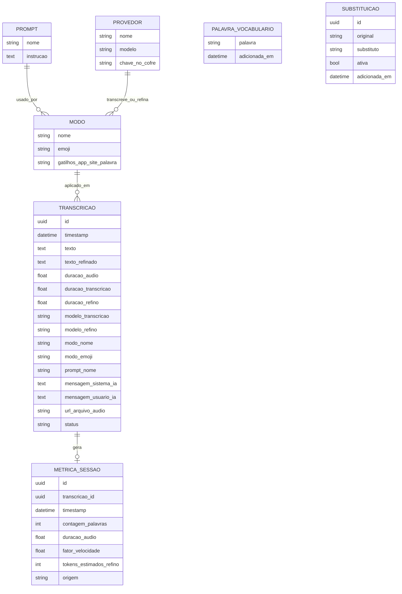

# Relatório de engenharia reversa: VoiceInk 2.13 (base do Voice Desk)

> Data: 2026-10-23 · Autor: Rafael (Product Manager) · Card: ENG-51
> Alvo: `/Applications/VoiceInk.app` no Mac do BD. `com.prakashjoshipax.VoiceInk`, versão 2.13 (build 213). Executável principal com SHA-256 `cb0c14d5e6cab348c8840541d8e29f31d411e6d9ef5f7d83b60d26b8adcb8ea1`, universal (x86_64 + arm64).
> Autorização: o BD confirmou o alvo ("VoiceLNK" = VoiceInk 2.13) e autorizou a análise pela rota (a) (comentários no ENG-51 em 2026-10-23). É a cópia instalada dele, analisada para construir um equivalente próprio para Mac e Windows. O VoiceInk tem código público sob GPL-3.0 (verificação da Helena no ENG-51); por isso este relatório descreve **comportamento e estrutura**, sem reproduzir código, textos ou marca.
> Ferramentas: REA 4.0.1 (CLI) com `inspect-macho` e `inspect-artifact`. A decompilação com o Hopper falhou na inicialização (`provider_timeout`), e o Ghidra não está instalado. Complementos por ferramentas de shell, rotulados como tal: `plutil`, `codesign`, `otool`, `strings`, `sqlite3` (só esquema) e `defaults` (só nomes de chaves).
> Cobertura: pacote do app, executável principal, helper XPC, frameworks embutidos, recursos, entitlements, preferências (só nomes), esquema dos bancos locais. **Ficaram de fora:** decompilação de funções, observação do app rodando (telas e estados) e tráfego de rede real.

> Aviso: este relatório descreve comportamento observado e estrutura inferida.
> Não contém nem reconstitui o código-fonte original do produto analisado.

## 1. Visão geral

**O que é.** O VoiceInk é um app de **ditado por voz para macOS** (14.4 ou superior) que fica na barra de menus. O usuário aciona um atalho global, fala, e o texto transcrito é **colado no app que está em foco**. A transcrição pode ser **local**, com modelos Whisper, Parakeet e outros rodando na máquina, ou **na nuvem**, com cerca de 10 provedores e modo em tempo real (streaming).

**Refinamento por IA.** Antes de colar, o texto pode ser **refinado por um modelo de linguagem** (LLM: nuvem, Ollama ou um modelo local num helper próprio). O refinamento segue um **modo** (ditado, e-mail, reescrever, resumir, traduzir, perguntar, assistente), escolhido automaticamente pelo app em uso, pelo site aberto no navegador ou por uma palavra-gatilho falada.

**Recursos de apoio.** Histórico de transcrições com áudio, vocabulário personalizado, substituição de palavras, estatísticas de uso e transcrição de arquivos de áudio.

**Modelo comercial.** Licença paga com teste grátis de 7 dias (EV-10, EV-12).

## 2. Perfis de usuário e permissões

| Perfil | Como foi identificado | Pode fazer |
|---|---|---|
| Usuário único local | Não há login nem conta de usuário. A identidade é a licença (EV-10, EV-12) e, opcionalmente, a conta iCloud (EV-04). | Tudo. |
| Estados de licença | Teste de 7 dias, licença ativa, limite de ativações, licença pendente de remoção (EV-10, EV-12). | **Inferido:** sem licença ou com o teste vencido, o uso fica restrito. O que exatamente é bloqueado é **Desconhecido**. |

Permissões do sistema pedidas (EV-03, EV-04):
- **Microfone.**
- **Gravação de tela:** contexto da tela, com OCR (EV-10).
- **Apple Events:** ler a URL do navegador.
- **Acessibilidade:** colar e ler o texto selecionado (EV-10).
- **Rede:** cliente e servidor.

O app roda **fora da sandbox**.

## 3. Mapa de funcionalidades

Confiança: **Observado** = visto no artefato com sentido inequívoco (metadado, permissão, texto de interface) · **Inferido** = deduzido de nomes de tipos, strings ou estrutura · **Desconhecido**. O app não foi visto rodando.

| ID | Área | Funcionalidade | Descrição | Evidência | Confiança |
|---|---|---|---|---|---|
| ER-01 | Gravação | Atalho global de gravação | Atalho principal configurável para iniciar e parar; atalhos extras por modo; atalho do painel do gravador. | EV-12 (`Shortcut_primaryRecording`), EV-09 (`RecordingShortcutManager`, `ModeShortcutManager`) | Inferido |
| ER-02 | Gravação | Cancelar gravação | Esc duas vezes cancela, por padrão; o atalho de cancelar é configurável. | EV-10 | Observado |
| ER-03 | Gravação | Gravador flutuante | Mini gravador flutuante e variante "notch" (no entalhe da tela do MacBook), com forma de onda e transcrição ao vivo. | EV-09 (`MiniRecorderPanel`, `NotchRecorderPanel`, `WaveformView`, `LiveTranscriptView`) | Inferido |
| ER-04 | Gravação | Escolha de microfone | Seleção do dispositivo de entrada, lembra o último usado e reage a troca de dispositivo. | EV-12, EV-09 (`AudioDeviceManager`), EV-10 | Inferido |
| ER-05 | Gravação | Sons de início e fim | 7 sons embutidos, mais sons personalizados. | EV-05, EV-12, EV-09 (`CustomSoundManager`) | Observado |
| ER-06 | Gravação | Pausar ou silenciar mídia | Pausa a mídia (música, vídeo) durante a gravação. | EV-10, EV-03 (`MediaRemoteAdapter`) | Observado |
| ER-07 | Gravação | Detecção de voz (VAD) | Liga e desliga a detecção de silêncio (modelo Silero embutido). | EV-05, EV-12 (`IsVADEnabled`) | Observado |
| ER-08 | Transcrição | Modelos locais | Whisper (whisper.cpp; o BD tem o large-v3-turbo baixado), Parakeet (inclusive em tempo real), Nemotron, SenseVoice, Paraformer, Apple Speech nativo e modelos Whisper importados pelo usuário. Baixa, gerencia e "aquece" os modelos. | EV-01, EV-09, EV-13 | Inferido |
| ER-09 | Transcrição | Provedores na nuvem | OpenAI, Groq, Deepgram, ElevenLabs, AssemblyAI, Mistral, Gemini, Soniox, Speechmatics, xAI, Cartesia, mais "compatível com OpenAI" personalizado. | EV-08, EV-09 | Inferido |
| ER-10 | Transcrição | Tempo real (streaming) | Texto aparece enquanto o usuário fala, via WebSocket dos provedores ou Parakeet local. | EV-08 (wss), EV-09 (`StreamingTranscriptionService`) | Inferido |
| ER-11 | Transcrição | Idioma e prompt | Idioma selecionável e prompt de transcrição (dica de vocabulário para o Whisper). | EV-12 (`SelectedLanguage`, `TranscriptionPrompt`) | Inferido |
| ER-12 | Transcrição | Transcrever arquivo | Transcrição de um arquivo de áudio arrastado ou escolhido. | EV-09 (`FileTranscriptionSession`, `AudioTranscribeView`), EV-04 (leitura de arquivo escolhido) | Inferido |
| ER-13 | Saída | Colar no app ativo | Cola simulando Cmd+V; alternativa via AppleScript para teclados com layout diferente; opção de enviar uma tecla depois de colar (ex.: Enter). | EV-10, EV-12 (`pasteMethod`, `AutoSendKey`) | Observado |
| ER-14 | Saída | Formatação e palavras de preenchimento | Formatação automática do texto; remoção de palavras de preenchimento ("é…", "tipo"). | EV-12 (`IsTextFormattingEnabled`), EV-09 (`FillerWordManager`) | Inferido |
| ER-15 | Refinamento | Refino por IA | Envia o texto (e o contexto) a um LLM com um prompt e cola o resultado. Provedores: OpenAI, Anthropic, Gemini, Groq, Mistral, Cerebras, OpenRouter, xAI, Ollama (local), LM Studio, "Local CLI" (um comando de terminal configurável) e "VoiceInk Refine" (modelo local num helper XPC). | EV-08, EV-09, EV-07, EV-10 | Inferido |
| ER-16 | Refinamento | Contexto | Usa como contexto o texto selecionado, a área de transferência, o texto da janela atual e o OCR da tela. | EV-10, EV-03, EV-04 | Observado (texto de interface) |
| ER-17 | Modos | Modos de uso | Modos com nome, emoji, prompt e modelos próprios. Modos citados: Ditado, Aprimorar, E-mail, Assistente, Reescrever, Perguntar, Resumir, Traduzir. Prompts personalizados. | EV-10, EV-11 (`ZMODENAME`, `ZMODEEMOJI`, `ZPROMPTNAME`), EV-12 (`modeConfigurationsV2`, `customPrompts`) | Observado |
| ER-18 | Modos | Troca automática de modo | Troca o modo pelo app em uso, pelo site aberto (10 navegadores via AppleScript) ou por palavra-gatilho falada. Cada palavra-gatilho pertence a um só modo. | EV-10, EV-05 (scripts por navegador), EV-03 | Observado |
| ER-19 | Modos | Assistente | Conversa com o assistente por voz (painel de chat com histórico de mensagens). | EV-09 (`AssistantChatService`, `AssistantPanelView`), EV-10 | Inferido |
| ER-20 | Dicionário | Vocabulário personalizado | Lista de palavras para melhorar o reconhecimento; adição rápida num painel. | EV-11 (`ZVOCABULARYWORD`), EV-09 (`DictionaryQuickAddPanel`) | Observado (esquema) |
| ER-21 | Dicionário | Substituição de palavras | Pares "original → substituto", cada um ativável. | EV-11 (`ZWORDREPLACEMENT`) | Observado (esquema) |
| ER-22 | Dicionário | Sincronizar pelo iCloud | Sincroniza o dicionário entre Macs pelo CloudKit. | EV-04 (CloudKit), EV-13 (`dictionary_ckAssets`) | Inferido |
| ER-23 | Histórico | Histórico de transcrições | Texto original, texto refinado, modelos usados, durações, modo, prompt e áudio. Busca, detalhe, reprodução do áudio e janela própria. | EV-11 (`ZTRANSCRIPTION`), EV-09 (`TranscriptionHistoryView`, `AudioPlayerView`), EV-13 (407 `.wav`) | Observado (esquema) |
| ER-24 | Histórico | Retenção e limpeza | Apaga automaticamente os áudios e o histórico depois do período configurado. | EV-10 | Observado |
| ER-25 | Histórico | Exportar e importar | Exportação em CSV; importação e exportação de configurações. | EV-09 (`VoiceInkCSVExportService`, `ImportExportService`) | Inferido |
| ER-26 | Painel | Estatísticas de uso | Palavras ditadas, duração, velocidade, tempo de refinamento, tokens estimados, por modelo e por modo. | EV-11 (`ZSESSIONMETRIC`), EV-09 (`DashboardView`, `DashboardInsightsView`), EV-13 | Observado (esquema) |
| ER-27 | Sistema | Barra de menus, iniciar com o sistema, atalhos do macOS | Ícone na barra de menus; iniciar no login; 2 ações no app Atalhos (alternar e fechar o gravador). | EV-09 (`MenuBarManager`, `LaunchAtLoginManager`), EV-06 | Observado |
| ER-28 | Sistema | Primeiro uso | Assistente de primeiro uso com permissões e configuração do atalho. | EV-09 (`OnboardingFlowController`, `OnboardingPermissionController`, `OnboardingShortcutSetupView`), EV-12 | Inferido |
| ER-29 | Sistema | Chaves de API seguras | Chaves dos provedores guardadas no Keychain, com links para obter cada chave. | EV-09 (`APIKeyManager`, `KeychainService`), EV-04, EV-08 (consoles) | Inferido |
| ER-30 | Comercial | Licença e teste | Ativar uma chave, comprar ou iniciar o teste de 7 dias; limite de ativações; licenças via Polar. | EV-10, EV-12, EV-08 (`polar.sh`) | Observado |
| ER-31 | Sistema | Atualização, avisos e diagnóstico | Atualização automática (Sparkle), avisos remotos (`announcements.json`), exportação de logs e relato de problema. | EV-03, EV-08, EV-10 | Observado |
| ER-32 | Incerto | Voz sintetizada (TTS) e identificação de falantes | Gerenciadores de TTS (Kokoro, PocketTTS, StyleTTS2 e outros) e diarização aparecem no binário. **Não está claro** se são funções do app ou só parte da biblioteca de áudio embutida. | EV-09 | Desconhecido |

## 4. Fluxos principais

### FL-01 Ditado no app ativo (o fluxo central)
1. O usuário está em qualquer app (e-mail, chat, editor) e aciona o atalho global (ER-01).
2. O gravador flutuante aparece, toca o som de início, a mídia pausa e a forma de onda mostra o áudio (ER-03, ER-05, ER-06).
3. O usuário fala; em modo streaming, o texto aparece ao vivo (ER-10).
4. O usuário aciona o atalho de novo para parar, ou Esc duas vezes para cancelar (ER-02).
5. O áudio é transcrito pelo modelo escolhido, local ou na nuvem (ER-08, ER-09). Depois o app aplica vocabulário, substituições, formatação e remoção de palavras de preenchimento (ER-11, ER-14, ER-20, ER-21).
6. Se o modo ativo tem refinamento, o texto e o contexto vão ao LLM (ER-15, ER-16).
7. O resultado é colado no app em foco e, opcionalmente, o app envia Enter (ER-13).
8. Fica registrado no histórico e nas estatísticas (ER-23, ER-26).

Resultado: texto pronto no campo onde o cursor estava.
Erros possíveis (vistos em texto de interface, **não** observados rodando): sem permissão de acessibilidade (não cola nem lê seleção), falha no AppleScript, provedor sem chave ou com timeout, nenhum texto detectado no OCR.
Evidências: EV-09, EV-10, EV-11.

### FL-02 Troca automática de modo
1. O usuário configura modos: nome, emoji, prompt, modelo, gatilhos por app, por site e por palavra falada (ER-17).
2. Ao gravar, o app identifica o app em foco e, se for navegador, a URL aberta (ER-18).
3. O modo correspondente é aplicado. Se o usuário falar uma palavra-gatilho, ela tem prioridade (**Inferido**; a ordem de prioridade é **Desconhecida**).

Evidências: EV-05, EV-10, EV-12.

### FL-03 Primeiro uso e licença
1. Primeiro uso: concede permissões (microfone, acessibilidade, tela), escolhe e baixa um modelo, define o atalho (ER-28).
2. Ativa a licença, compra ou inicia o teste de 7 dias (ER-30).

Evidências: EV-09, EV-10, EV-12.

### FL-04 Transcrever arquivo
1. O usuário abre a área de transcrição, arrasta ou escolhe um arquivo de áudio.
2. O app transcreve e, opcionalmente, refina.
3. O resultado vai para o histórico.

Evidências: EV-09; o fluxo é **Inferido**.

### FL-05 Consultar e gerenciar o histórico
1. O usuário abre o histórico, busca, vê o detalhe (texto original e refinado, modelo, duração), ouve o áudio, copia ou reprocessa.
2. Pode exportar em CSV.

Evidências: EV-09, EV-11; o fluxo é **Inferido**.

## 5. Telas

Não foram capturadas: o app não foi visto rodando. Pelos nomes das views (EV-09), as áreas são:
- Painel com estatísticas e insights.
- Histórico e detalhe da transcrição.
- Modelos de transcrição (cards por modelo, download, importação).
- Modelos de refino e provedores (nuvem, local, personalizados).
- Modos, com editor, seletor de ícone e gatilhos.
- Dicionário: vocabulário e substituições.
- Configurações: atalhos, áudio, sons, colagem, retenção, diagnóstico, atualização.
- Licença.
- Primeiro uso.
- Gravador mini e gravador notch.
- Painel do assistente.
- Menu da barra de menus.

Estados vistos em texto de interface: dias restantes do teste, download de modelo em andamento, erros de provedor. **Telas e estados reais ficam para uma rodada de observação**, se o BD quiser (seção 11).

## 6. APIs observadas

O VoiceInk não tem backend próprio para a função central: fala direto com APIs de terceiros usando a chave do próprio usuário. Lista normalizada em EV-08.

| Método | Endpoint (normalizado) | Usado em | Autenticação | Evidência |
|---|---|---|---|---|
| POST (inferido) | `api.openai.com/v1/audio/transcriptions` e equivalentes (Groq, Mistral, ElevenLabs, xAI, Deepgram `listen`, AssemblyAI `upload` + `transcript`, Soniox `files` + `transcriptions`, Speechmatics `jobs`, Gemini `upload`) | Transcrição em lote | Chave do usuário (inferido: cabeçalho Bearer ou equivalente) | EV-08 |
| WebSocket | `wss://` de Deepgram, AssemblyAI, ElevenLabs, Mistral, Gemini, Soniox, Speechmatics, xAI, Cartesia | Transcrição em tempo real | Chave do usuário | EV-08 |
| POST (inferido) | `…/v1/chat/completions` (OpenAI, Groq, Mistral, Cerebras, OpenRouter), `api.anthropic.com/v1/messages`, Gemini `models`/`interactions` | Refinamento por IA | Chave do usuário | EV-08 |
| GET (inferido) | `…/v1/models`, `openrouter.ai/api/v1/key`, `api.elevenlabs.io/v1/user` | Listar modelos e validar chave | Chave do usuário | EV-08 |
| HTTP local | `localhost:11434` | Ollama (LLM local) | Nenhuma | EV-08 |
| GET | `huggingface.co/.../resolve` | Download de modelos locais | Nenhuma | EV-08 |
| GET | `beingpax.github.io/VoiceInk/appcast.xml`, `…/announcements.json` | Atualização e avisos | Nenhuma | EV-03, EV-08 |
| (desconhecido) | `api.polar.sh` | Ativação e validação de licença | Chave de licença | EV-08 |

Notas: formatos exatos de entrada e saída, limites e tratamento de erro não foram observados (sem tráfego real).

## 7. Modelo de dados inferido

O esquema vem dos bancos locais SwiftData (`default.store`, `dictionary.store` e `stats.store` têm o mesmo esquema) e das chaves de preferência. Só a estrutura foi lida; nenhum dado.

| Entidade | Campos inferidos | Origem da inferência | Confiança |
|---|---|---|---|
| Transcrição | No diagrama | Tabela `ZTRANSCRIPTION` (EV-11) | Observado (esquema) |
| Métrica de sessão | No diagrama | Tabela `ZSESSIONMETRIC` (EV-11) | Observado (esquema) |
| Palavra do vocabulário | palavra, data | Tabela `ZVOCABULARYWORD` (EV-11) | Observado (esquema) |
| Substituição | original, substituto, ativa, data | Tabela `ZWORDREPLACEMENT` (EV-11) | Observado (esquema) |
| Modo, prompt, provedor | Nomes, gatilhos, modelo | Preferências `modeConfigurationsV2`, `customPrompts`, `selectedAIProvider`, `*SelectedModel` (EV-12) e Keychain (EV-04) | Inferido |

Arquivos locais (EV-13):
- Pasta de gravações `.wav`, uma por transcrição.
- Pasta de modelos baixados.
- Snapshot JSON das estatísticas do painel.

## 8. Integrações externas

- **Transcrição na nuvem:** OpenAI, Groq, Deepgram, ElevenLabs, AssemblyAI, Mistral, Google Gemini, Soniox, Speechmatics, xAI, Cartesia, e qualquer API compatível com a da OpenAI.
- **LLM para refinamento:** OpenAI, Anthropic, Gemini, Groq, Mistral, Cerebras, OpenRouter, xAI; locais: Ollama, LM Studio, comando de terminal ("Local CLI") e modelo próprio no helper XPC.
- **Modelos locais:** whisper.cpp (Whisper), FluidAudio (Parakeet, Nemotron e outros, rodando no Neural Engine e na GPU da Apple), Apple Speech, motor de transcrição próprio (`CTranscribe`).
- **Sistema macOS:**
  - Acessibilidade (colar, ler seleção).
  - ScreenCaptureKit + Vision (OCR da tela).
  - AppleScript (URL de 10 navegadores).
  - MediaRemote (pausar mídia; framework privado da Apple).
  - CloudKit (sincronizar dicionário).
  - Keychain (chaves).
  - App Intents (app Atalhos).
  - Login item (iniciar com o sistema).
- **Comercial e operação:** Polar (licenças), Sparkle (atualização), GitHub Pages (avisos), Hugging Face (download de modelos).

Evidências: EV-01, EV-03, EV-04, EV-05, EV-07, EV-08.

## 9. Regras de negócio observadas

- Teste grátis de **7 dias**; depois é preciso ativar uma chave de licença, com **limite de ativações** (EV-10, EV-12).
- **Esc duas vezes** cancela a gravação por padrão; quem reatribuir o atalho de cancelar perde esse comportamento até restaurar o padrão (EV-10).
- **Cada palavra-gatilho pertence a um único modo** (EV-10).
- Retenção: histórico e áudios são apagados automaticamente depois do período configurado, com controles separados para áudio e para histórico (EV-10).
- O contexto (seleção, área de transferência, janela, tela) só é usado quando é relevante, e a resposta não deve citar contexto desnecessário (instrução do prompt de sistema, EV-10).
- Sem permissão de acessibilidade, a captura do texto selecionado é ignorada (EV-10).

## 10. Pontos fracos e oportunidades

Fatos:
- **Só macOS:** depende de APIs exclusivas da Apple (seção 8), algumas privadas (MediaRemote).
- **Amplitude grande:** cerca de 10 provedores de transcrição, cerca de 10 de LLM e 6 famílias de modelos locais. A configuração inicial pesa.
- **Comercial embutido no produto:** licença, teste, convite para dar estrela no GitHub, afiliados e avisos remotos.

Opinião (Rafael):
- Para o uso do BD em duas máquinas, o valor está no **fluxo central** (FL-01) com **modos** e **dicionário**, e numa **configuração que siga o usuário entre Mac e Windows** (hoje o iCloud só cobre o dicionário e só entre Macs).
- Dá para entregar uma v1 bem mais enxuta, sem perder o que importa no dia a dia.

## 11. Desconhecidos e limites da análise

- **Decompilação não feita:** o Hopper não iniciou nesta execução sem interação (`provider_timeout`), e o Ghidra não está instalado. Lógica fina (prioridade entre gatilhos, regras exatas da licença, ordem do pipeline de texto) ficou **Desconhecida**. Para responder: rodar o Hopper numa sessão interativa no Mac do BD, ou instalar o Ghidra e definir `GHIDRA_INSTALL_DIR`.
- **App não observado rodando:** sem telas nem estados reais. Para responder: rodada de observação com `capture-native-ui-scenario` do REA, com o BD acompanhando (o app usa microfone e tela dele).
- **Sem tráfego real:** formatos de requisição e resposta só por inferência. Para responder: captura HAR/mitmproxy de uma sessão de teste.
- **TTS e identificação de falantes (ER-32):** não se sabe se são funções do app ou só código da biblioteca de áudio.
- **"Local CLI":** o propósito exato (provavelmente refinar o texto com um comando local qualquer) é **Inferido**.
- **Divergência de versão mínima:** o pacote pede macOS 14.4; o README público citaria 15.0 (comentário da Helena). Não afeta o Voice Desk.
- **Integração MCP do REA:** a integração MCP não conectou nesta sessão. Usei o REA pela linha de comando (CLI). O cache do npm do `rea-agents@4.0.1` estava corrompido e foi refeito.

## 12. Índice de evidências

| ID | Tipo | Arquivo / ID REA | Descrição |
|---|---|---|---|
| EV-01 | REA `inspect_macho` | `ev_89ac3bac9254e4f18a31eeed4be8ba7078983a09db7780533ef5a89d81530d2a` · `evidencias/EV-01-rea-inspect-macho.json` | Identidade do executável, arquiteturas, macOS 14.4, SDK 26.5, frameworks do sistema e embutidos |
| EV-02 | REA `inspect_artifact` | `ev_a3d53e51b34e3c58b5aef2d7ebe5fd49577b4d2e5dcc65a482f50ba27fa99219` · `evidencias/EV-02-rea-inspect-artifact.json` | Inventário do pacote (214 artefatos: 97 contêineres, 10 executáveis, recursos) |
| EV-03 | Shell (`plutil`) | `Contents/Info.plist` | Bundle, versão, textos de permissão (microfone, tela, Apple Events), feed do Sparkle |
| EV-04 | Shell (`codesign`) | Entitlements do executável | Fora da sandbox, áudio, tela, Apple Events, rede cliente e servidor, CloudKit, Keychain, push |
| EV-05 | Shell (`ls`) | `Contents/Resources` | Scripts de URL de 10 navegadores, 7 sons, modelo VAD Silero, idiomas en, de, zh-Hans |
| EV-06 | Shell | `Resources/Metadata.appintents` | 2 ações no app Atalhos: alternar e fechar o gravador |
| EV-07 | Shell (`otool`) | `XPCServices/VoiceInkRefineXPC.xpc` | Helper de refino local (Metal, Accelerate) |
| EV-08 | Shell (`strings`) | `evidencias/EV-08-endpoints.md` | Endpoints HTTPS e WSS normalizados |
| EV-09 | Shell (`strings`) | `evidencias/EV-09-tipos-swift.md` | Nomes de tipos (serviços, provedores, views) |
| EV-10 | Shell (`strings` + `Localizable.strings`) | Executável principal | Textos de interface sobre modos, teste, retenção, colagem, Esc, contexto. Usados só para entender comportamento, **não para copiar** |
| EV-11 | Shell (`sqlite3`, só esquema, cópia privada já apagada) | `default.store`, `dictionary.store`, `stats.store` | Tabelas `ZTRANSCRIPTION`, `ZSESSIONMETRIC`, `ZVOCABULARYWORD`, `ZWORDREPLACEMENT` |
| EV-12 | Shell (`defaults`, só nomes de chaves) | `com.prakashjoshipax.VoiceInk.plist` | Chaves de modos, prompts, provedor, colagem, atalhos, sons, VAD, licença |
| EV-13 | Shell (`ls`) | `~/Library/Application Support/com.prakashjoshipax.VoiceInk` | Pastas de gravações (`.wav`), modelos (Whisper large-v3-turbo q5), bancos e snapshot de estatísticas |
| EV-14 | Comentário no card | ENG-51 (Helena, 2026-10-23) | Código público em `Beingpax/VoiceInk`, GPL-3.0; README cita macOS 15 |

Nenhum segredo, token, conteúdo de transcrição ou áudio foi lido ou registrado.
